<picture>
  <source media="(max-width: 768px)" srcset="https://raw.githubusercontent.com/23Barajapu/23Barajapu/main/assets/m/header.svg?v=3" />
  
</picture>

<div align="center">

<a href="https://github.com/23Barajapu"></a>

<a href="https://www.linkedin.com/in/barajapu/"></a>
<a href="https://www.instagram.com/barajapu_"></a>
<a href="https://bara-portfolio-self.vercel.app/"></a>
<a href="mailto:barajapu23@gmail.com"></a>

<br />

<a href="https://github.com/23Barajapu?tab=followers"></a>
<a href="https://github.com/23Barajapu?tab=repositories"></a>


</div>

<picture>
  <source media="(max-width: 768px)" srcset="https://raw.githubusercontent.com/23Barajapu/23Barajapu/main/assets/m/section-about.svg?v=3" />
  
</picture>

<p align="center"></p>

Saya adalah seorang **Web & Mobile Developer** dan **Tech Innovator** yang berfokus pada pengembangan antarmuka pengguna yang interaktif, responsif, dan berkinerja tinggi. Memiliki passion mendalam dalam mentransformasikan ide serta rancangan arsitektur kompleks menjadi aplikasi web dan mobile yang intuitif dengan seamless user experience.

Saat ini mengemban amanah sebagai **Ketua Himpunan Mahasiswa Teknologi Informasi dan Komputer (HIMATIKOM)** di **Politeknik Negeri Subang** periode 2024–2025, setelah sebelumnya berkontribusi aktif sebagai **Anggota Departemen Pengembangan Sumber Daya Anggota (PSDA) HIMATIKOM** (2023–2024). Terbiasa memimpin tim, mengelola proyek kolaboratif, serta mengeksplorasi ekosistem teknologi modern mulai dari Next.js, TypeScript, Laravel, hingga native scripting PowerShell dan AI workflows.

**🚧 Proyek Pilihan (What I'm building)**

- 🎧 **[BINAR (Bina Netra)](https://github.com/23Barajapu/Binar)**: Platform literasi buku suara & ujian mandiri berbasis aturan untuk siswa tunanetra (SLB Negeri Subang). Dibangun dengan arsitektur **Rust Modular Monolith** di backend dan **Flutter Zero-Visual Gesture UI** di mobile.
- 🧹 **[cleaner-windows](https://github.com/23Barajapu/cleaner-windows)**: Windows Deep Uninstaller & Root Cleaner native TUI berbasis PowerShell & Win32 API.
- 💳 **[money-management](https://github.com/23Barajapu/money-management)**: Personal finance & expense tracker interaktif dengan visualisasi analytics berbasis React, TypeScript, Supabase, dan Expo.
- 🌾 **SIMPADA**: Sistem Informasi Pertanian & Monitoring Lahan Daun Padi / Tembakau dengan integrasi WebGIS menggunakan PHP Laravel dan MySQL.
- 🚗 **Biro Jasa Mahkota**: Enterprise management system untuk pengurusan dokumen administrasi kendaraan bermotor (STNK, BPKB, Balik Nama, dan Mutasi).

**🧠 Keahlian & Ketertarikan (What I'm into)**

- 🦀 **Systems & Inklusi Digital**: Pemrograman performa tinggi dan handal menggunakan **Rust** (Modular Monolith, Rule Engines, Actix/Axum) dan klien mobile **Flutter** berbasis zero-visual canvas untuk aksesibilitas siswa tunanetra.
- ⚡ **Modern Frontend**: React, Next.js 13+, TypeScript, Tailwind CSS, Three.js & Framer Motion untuk antarmuka berkecepatan tinggi.
- 🛠️ **Fullstack & Backend**: PHP (Laravel), Python (Django), PostgreSQL, Redis, MySQL, Supabase, RESTful API & JWT authentication.
- 🤖 **AI-Driven Workflows**: Pemanfaatan AI agents, Google Antigravity, Speech-to-Text (STT), Text-to-Speech (TTS), dan OCR engine (Tesseract).
- 🖥️ **System Utilities & Shell**: PowerShell automation, native Windows optimization, dan developer tooling.
- 👥 **Leadership & Community**: Manajemen organisasi mahasiswa (Ketua HIMATIKOM & mantan Anggota Dept. PSDA), mentoring teknis, dan public speaking di bidang teknologi informasi.

**⚡ Quick Facts**

- 📍 Berdomisili di **Subang, Jawa Barat, Indonesia 🇮🇩**
- 🎓 Mahasiswa Teknologi Informasi & **Ketua HIMATIKOM Politeknik Negeri Subang (2024 - 2025)**
- ☕ Didorong oleh rasa ingin tahu tinggi, clean code, lo-fi beats, dan secangkir kopi
- 💬 Terbuka untuk diskusi seputar Web/Mobile Dev, Laravel, React, TypeScript, UI/UX, atau organisasi
- 🤝 Siap berkolaborasi untuk proyek open source, software engineering, maupun inovasi digital

<picture>
  <source media="(max-width: 768px)" srcset="https://raw.githubusercontent.com/23Barajapu/23Barajapu/main/assets/m/neofetch.svg?v=3" />
  
</picture>

> *Coding dreams into reality, one line at a time.* ✨

<picture>
  <source media="(max-width: 768px)" srcset="https://raw.githubusercontent.com/23Barajapu/23Barajapu/main/assets/m/divider.svg?v=3" />
  
</picture>

<picture>
  <source media="(max-width: 768px)" srcset="https://raw.githubusercontent.com/23Barajapu/23Barajapu/main/assets/m/section-projects.svg?v=3" />
  
</picture>

<p align="center">
  <a href="https://github.com/23Barajapu/Binar"></a>
  <a href="https://github.com/23Barajapu/cleaner-windows"></a>
  <a href="https://github.com/23Barajapu/money-management"></a>
  <a href="https://github.com/23Barajapu?tab=repositories"></a>
</p>

<p align="center">
  <a href="https://github.com/23Barajapu/Binar"></a>
  
  
  
</p>

<p align="center">
  <a href="https://github.com/23Barajapu/cleaner-windows"></a>
  
  
  
</p>

<p align="center">
  <a href="https://github.com/23Barajapu/money-management"></a>
  
  
  
</p>

<p align="center"><sub>🚀 Jelajahi seluruh repositori kode saya di <a href="https://github.com/23Barajapu?tab=repositories">GitHub Repositories</a> dan preview interaktif di <a href="https://bara-portfolio-self.vercel.app/">Bara Portfolio</a>.</sub></p>

<picture>
  <source media="(max-width: 768px)" srcset="https://raw.githubusercontent.com/23Barajapu/23Barajapu/main/assets/m/section-journey.svg?v=3" />
  
</picture>

<picture>
  <source media="(max-width: 768px)" srcset="https://raw.githubusercontent.com/23Barajapu/23Barajapu/main/assets/m/timeline.svg?v=3" />
  
</picture>

<picture>
  <source media="(max-width: 768px)" srcset="https://raw.githubusercontent.com/23Barajapu/23Barajapu/main/assets/m/divider.svg?v=3" />
  
</picture>

<picture>
  <source media="(max-width: 768px)" srcset="https://raw.githubusercontent.com/23Barajapu/23Barajapu/main/assets/m/section-stack.svg?v=3" />
  
</picture>

<picture>
  <source media="(max-width: 768px)" srcset="https://raw.githubusercontent.com/23Barajapu/23Barajapu/main/assets/m/marquee.svg?v=3" />
  
</picture>

<picture>
  <source media="(max-width: 768px)" srcset="https://raw.githubusercontent.com/23Barajapu/23Barajapu/main/assets/m/stack.svg?v=3" />
  
</picture>

<picture>
  <source media="(max-width: 768px)" srcset="https://raw.githubusercontent.com/23Barajapu/23Barajapu/main/assets/m/section-ai.svg?v=3" />
  
</picture>

<picture>
  <source media="(max-width: 768px)" srcset="https://raw.githubusercontent.com/23Barajapu/23Barajapu/main/assets/m/ai-orbit.svg?v=3" />
  
</picture>

<picture>
  <source media="(max-width: 768px)" srcset="https://raw.githubusercontent.com/23Barajapu/23Barajapu/main/assets/m/divider.svg?v=3" />
  
</picture>

<picture>
  <source media="(max-width: 768px)" srcset="https://raw.githubusercontent.com/23Barajapu/23Barajapu/main/assets/m/section-stats.svg?v=3" />
  
</picture>

<div align="center">



</div>

<picture>
  <source media="(max-width: 768px)" srcset="https://raw.githubusercontent.com/23Barajapu/23Barajapu/main/assets/m/section-city.svg?v=3" />
  
</picture>

<picture>
  <source media="(prefers-color-scheme: dark)" srcset="https://raw.githubusercontent.com/23Barajapu/23Barajapu/output/profile-night-rainbow.svg" />
  <source media="(prefers-color-scheme: light)" srcset="https://raw.githubusercontent.com/23Barajapu/23Barajapu/output/profile-season-animate.svg" />
  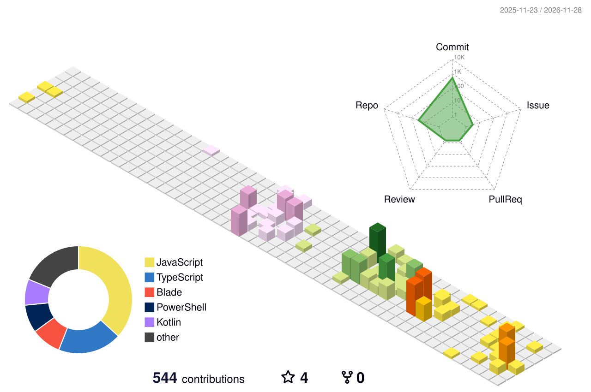
</picture>

<picture>
  <source media="(max-width: 768px)" srcset="https://raw.githubusercontent.com/23Barajapu/23Barajapu/main/assets/m/divider.svg?v=3" />
  
</picture>

<picture>
  <source media="(max-width: 768px)" srcset="https://raw.githubusercontent.com/23Barajapu/23Barajapu/main/assets/m/section-arcade.svg?v=3" />
  
</picture>

My commits, eaten by a snake, chased by Pac-Man and smashed in Breakout. Refreshed every day.

**🐍 Snake**

<picture>
  <source media="(prefers-color-scheme: dark)" srcset="https://raw.githubusercontent.com/23Barajapu/23Barajapu/output/github-snake-dark.svg" />
  <source media="(prefers-color-scheme: light)" srcset="https://raw.githubusercontent.com/23Barajapu/23Barajapu/output/github-snake.svg" />
  
</picture>

**👾 Pac-Man**

<picture>
  <source media="(prefers-color-scheme: dark)" srcset="https://raw.githubusercontent.com/23Barajapu/23Barajapu/output/pacman-contribution-graph-dark.svg" />
  <source media="(prefers-color-scheme: light)" srcset="https://raw.githubusercontent.com/23Barajapu/23Barajapu/output/pacman-contribution-graph.svg" />
  
</picture>

**🧱 Breakout**

<picture>
  <source media="(prefers-color-scheme: dark)" srcset="https://raw.githubusercontent.com/23Barajapu/23Barajapu/output/breakout-contribution-graph-dark.svg" />
  <source media="(prefers-color-scheme: light)" srcset="https://raw.githubusercontent.com/23Barajapu/23Barajapu/output/breakout-contribution-graph.svg" />
  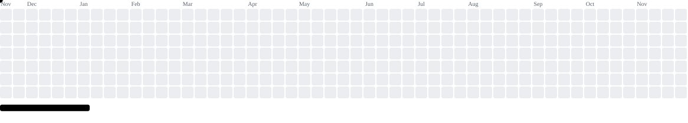
</picture>

<picture>
  <source media="(max-width: 768px)" srcset="https://raw.githubusercontent.com/23Barajapu/23Barajapu/main/assets/m/divider.svg?v=3" />
  
</picture>

<picture>
  <source media="(max-width: 768px)" srcset="https://raw.githubusercontent.com/23Barajapu/23Barajapu/main/assets/m/section-guestbook.svg?v=3" />
  
</picture>

<p align="center">Tinggalkan pesan Anda! Pesan akan tampil otomatis di sini. 👇</p>

<p align="center">
  <a href="https://github.com/23Barajapu/23Barajapu/issues/new?template=guestbook.yml"></a>
</p>

<!-- GUESTBOOK:START -->
| | Visitor | Message | Date |
|:-:|---|---|---|
|  | [23Barajapu](https://github.com/23Barajapu) | Halo semuanya! Selamat datang di profil GitHub saya ✨ Tinggalkan pesan di bawah ya 👇 | 2026-11-19 |
<!-- GUESTBOOK:END -->

<picture>
  <source media="(max-width: 768px)" srcset="https://raw.githubusercontent.com/23Barajapu/23Barajapu/main/assets/m/section-break.svg?v=3" />
  
</picture>

<picture>
  <source media="(max-width: 768px)" srcset="https://raw.githubusercontent.com/23Barajapu/23Barajapu/main/assets/m/break.svg?v=3" />
  
</picture>

<div align="center">


**Terima kasih telah berkunjung!** ⭐ Dibuat dengan ☕ dari Subang, Indonesia. Jangan ragu menjelajahi repositori saya.

<details>
<summary>🥚 <b>psst... klik di sini</b></summary>
<br />

```console
$ sudo make me a sandwich
[sudo] password for visitor: ********
🥪 Siap! Hanya karena Anda sudah scroll sampai sejauh ini.

$ cat ~/.secret
☕ Fakta menarik: sebagian besar seni visual di halaman ini adalah SVG murni, dirancang dengan penuh dedikasi.
🐾 Kucing yang tidur di meja adalah kucing yang sama yang berlari di antara setiap bagian.
🎁 Menemukan pesan ini? Tulis "kopi" di guestbook agar saya tahu Anda mampir!
```

</details>

</div>

<picture>
  <source media="(max-width: 768px)" srcset="https://raw.githubusercontent.com/23Barajapu/23Barajapu/main/assets/m/footer.svg?v=3" />
  
</picture>
